# BFS and PageRank on an Apple M2 GPU with Metal

## Abstract

This project implements breadth-first search (BFS) and PageRank as Metal compute
kernels on an 8 GB Apple M2 and compares them with our own OpenMP CPU baselines
and with the GAP Benchmark Suite (the state-of-the-art CPU reference) on six
SNAP graphs. Every GPU result is checked against a serial CPU reference. BFS must
match exactly; PageRank must have L1 error below 1e-4, with the reference itself
cross-checked against NetworkX.

**BFS.** The best variant is a direction-optimizing BFS that runs small levels on
the CPU, working in place on the GPU's buffers (no copies, thanks to unified memory).
- It reaches **4.6–8.0 GTEPS** on the social graphs (LiveJournal 8.8 ms per traversal).
- That is **1.7–2.3× faster than GAP's 8-thread BFS** (which our `cpu_do` matches
  within 0–10%) and **41–46× faster than serial**.
- On the road network (600+ levels), every GPU-only variant is limited by the
  ~0.2 ms fixed cost of each level. The hybrid wins by running nearly all levels
  on the CPU, and ties GAP restricted to the 4 performance cores.

**PageRank.**
- Pull-based kernels beat atomic push by 1.5–4.9×.
- A degree-adaptive pull kernel is within 10% of the best variant on every graph.
- **Per iteration**, the best GPU variant is 1.0–2.6× faster than GAP's 8-thread
  PageRank (and 1.5–4.8× faster than our weaker `cpu_omp`).
- **To convergence, GAP wins on every graph (1.1–2.1×).** Its Gauss–Seidel updates
  need 29–34 iterations where the GPU's Jacobi iteration needs 44–62.
- Real input orderings already carry most of the available locality: random labels
  slow PageRank 2–3×. Reverse Cuthill–McKee (RCM) improves on the input order for
  PageRank but *hurts* direction-optimizing BFS, because it delays bottom-up
  early exits.

**Efficiency.** Measured against the 95 GB/s sequential bandwidth we measured, the
best BFS reaches 84 MTEPS per GB/s on Orkut.

## 1. Hardware and software

| item | value |
|---|---|
| chip | Apple M2: 4 performance + 4 efficiency CPU cores, 10-core GPU (Apple8 / Metal 3) |
| memory | 8 GB LPDDR5 unified, 102.4 GB/s theoretical |
| measured bandwidth | GPU sequential read **95.3 GB/s**, write 96.2 GB/s; CPU (8 threads) read 64.2 GB/s |
| GPU limits | 32-wide simdgroups, ≤ 1024 threads per threadgroup, 32 KB threadgroup memory |
| system-level cache | 8 MB (shared by CPU and GPU) |
| software | macOS 26.2, Apple clang 14.0.3 (C++17, Obj-C++), Homebrew libomp, Command Line Tools only |

There is no offline `metal` compiler without Xcode, so shaders are compiled at
runtime from source (MSL 3.0, fast math off; Kahan summation depends on that).
All buffers use shared storage, so CPU and GPU see the same bytes.

All numbers in this report come from a single `scripts/run_all.sh` run on
2026-10-19, on AC power with Low Power Mode off and other apps closed. Peak process
memory was 2.7 GB.

## 2. Datasets

| dataset | type | n | m (stored) | undirected edges | mean deg | max deg | components | approx. diameter | .bin MB |
|---|---|---|---|---|---|---|---|---|---|
| ego-Facebook | undirected | 4,039 | 176,468 | 88,234 | 43.7 | 1,045 | 1 | 7 | 1 |
| web-Google | directed | 875,713 | 5,105,039 | 4,322,051 | 5.8 | 456 | 2,746 | 16 | 23 |
| roadNet-CA | undirected | 1,965,206 | 5,533,214 | 2,766,607 | 2.8 | 12 | 2,638 | 773 | 29 |
| soc-Pokec | directed | 1,632,803 | 30,622,564 | 22,301,964 | 18.8 | 8,763 | 1 | 10 | 123 |
| soc-LiveJournal1 | directed | 4,847,571 | 68,475,391 | 42,851,237 | 14.1 | 20,292 | 1,876 | 14 | 280 |
| com-Orkut | undirected | 3,072,441 | 234,370,166 | 117,185,083 | 76.3 | 33,313 | 1 | 8 | 906 |

The graphs come from SNAP and are stored as binary CSR. A streaming two-pass
converter keeps peak memory at about 4 bytes per edge.
- BFS runs on the symmetrized graph.
- PageRank runs on the directed graph: it pulls over the transpose and pushes over the forward CSR.
- An adversarial `star100k` graph (one hub with 100K leaves) and seven other
  synthetic graphs are used for tests and the load-imbalance experiment.

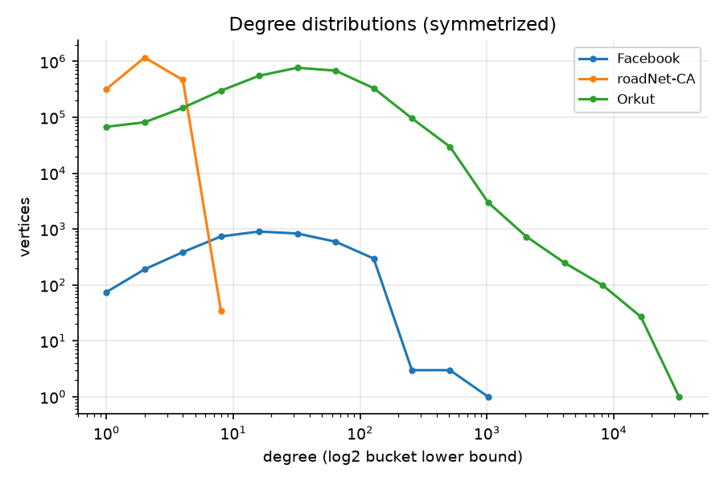

*Figure 2: degree distributions (log-log).* The four social and web graphs are
heavy-tailed: max degree is 100–400× the mean. roadNet-CA is the opposite, with
every vertex of degree ≤ 12. This difference drives most results below.

## 3. Method

**Variants.** All variants can be selected with `gbench --variant`.

BFS:

| variant | idea |
|---|---|
| `cpu_serial` | queue BFS; the reference |
| `cpu_omp` | level-synchronous top-down; static / dynamic,64 / guided schedules |
| `cpu_do` | direction-optimizing (Beamer), GAP rule α = 15, β = 18 |
| `gpu_vertex` | one thread per vertex every level, no queue |
| `gpu_naive` | one thread per frontier vertex; CAS claim, atomic queue append |
| `gpu_binned` | degree bins: simdgroup-cooperative small lists, simdgroup per medium vertex, threadgroup per large vertex (Merrill-style) |
| `gpu_edge` | exclusive scan of frontier degrees, then a fixed 2 edges per thread, found by binary search |
| `gpu_do` | GPU direction-optimizing: `gpu_edge` top-down; bottom-up over a bitmap frontier with early exit. Same switching decisions as `cpu_do`, verified level by level in the tests |
| `hybrid` | `gpu_do`, but levels with fewer than T = 10⁵ edges of work run on the CPU (4 threads) directly on the shared buffers |

PageRank (d = 0.85, dangling mass redistributed):

| variant | idea |
|---|---|
| `cpu_serial` | double precision, pull; the reference |
| `cpu_omp` | double, pull, dynamic schedule |
| `gpu_push` | float atomics with simdgroup aggregation and compensation |
| `gpu_pull_scalar` | thread per vertex |
| `gpu_pull_vector` | simdgroup per vertex, `simd_sum` |
| `gpu_pull_adaptive` | vertices binned once by in-degree: thread / simdgroup / threadgroup per vertex |

GPU pull kernels use Kahan summation per accumulator.

**Measurement.**

BFS:
- 64 fixed random sources in the largest component (Graph500-style), the same for every variant.
- 2 global warm-up runs; then each source gets 1 untimed warm-up run (the CPU reference that precedes it evicts caches and lets the GPU clock drop), then 5 timed trials; we report the per-source median.
- **Time is end to end** and includes the host sync after every level. GPU-only time is recorded too.
- **GTEPS** = undirected edges in the source's component ÷ time, as a harmonic mean
  over sources. The denominator is the same for every variant, so direction-optimizing
  variants get no credit for edges they skip.

PageRank:
- **ms per iteration** over 20 fixed iterations (2 warm-up + 5 timed runs). The fixed
  run is encoded in one command buffer.
- Convergence runs use tol = 1e-6 and sync every iteration.

**Validation.**
- Every variant is validated on every dataset before it is timed.
- BFS: `dist` must equal `cpu_serial` exactly.
- PageRank: L1 < 1e-4, top-1000 relative error < 1e-3, sum = 1 ± 1e-4.
- `make test`: 24 test groups covering converter, transforms, permutations,
  primitives, and every variant on every synthetic graph at several threadgroup sizes.
- `tools/validate_networkx.py`: 45/45 checks of the CPU references against
  NetworkX. Worst PageRank L1 is 3e-15.

## 4. Experiments

### 4.1 Memory system microbenchmarks

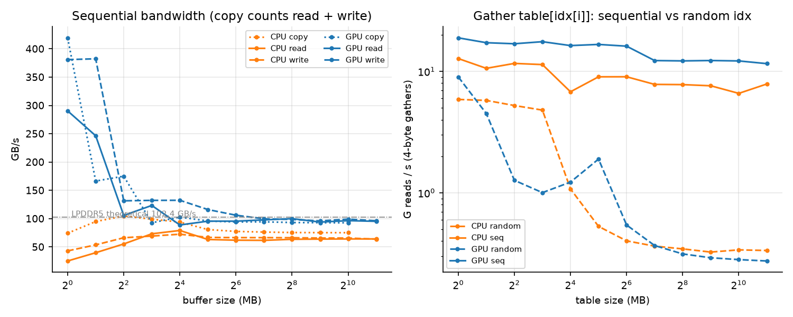

*Figure 1: left, sequential bandwidth vs buffer size; right, rate of 4-byte gathers
`table[idx[i]]` with sequential vs uniformly random `idx`.*

**Sequential bandwidth.** The GPU reaches 95 GB/s on DRAM-sized buffers, 93% of the
LPDDR5 theoretical peak. Eight CPU threads saturate at ~64 GB/s. Small buffers show
cache bandwidth (up to ~400 GB/s for 1 MB).

**Random gathers.** This is the number that matters for graphs. Once the table
exceeds the 8 MB system-level cache, the GPU sustains only **~0.28 G random
gathers/s** vs ~12 G/s sequential, a 40× gap. The CPU is about the same (~0.32 G/s).
Each random 4-byte read costs a full cache line, and the GPU's latency hiding cannot
make up for that in DRAM. So on graph workloads the GPU's advantage comes from
parallelism and doing less work, not from a faster memory path.

**Dispatch costs.**
- A commit + wait round trip costs **111 µs**.
- A dependent dispatch inside one encoder costs 0.6 µs.

Together, these two numbers explain the road-network results in 4.3.

### 4.2 Frontier shape

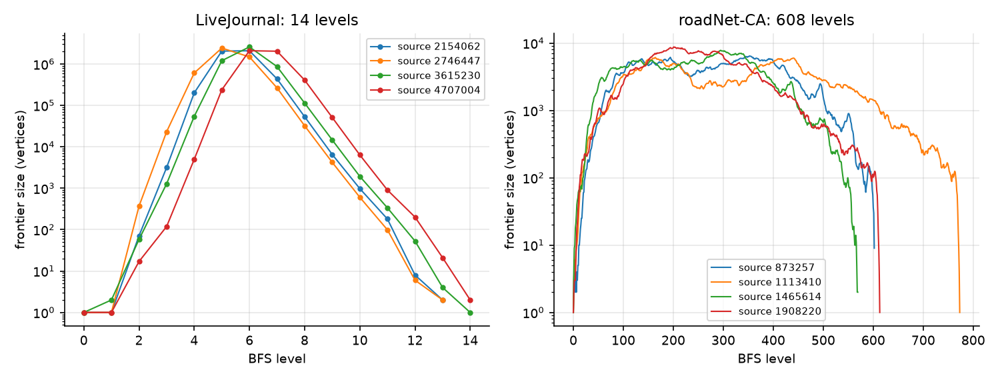

*Figure 3: frontier size per level for 4 sources.*

**LiveJournal** has the classic small-world shape: 14 levels. The frontier grows to
2.5M vertices (half the graph) by level 5–6 and then collapses. Nearly all the work
is in 2–3 levels, which is exactly where bottom-up pays off.

**roadNet-CA** needs ~600–770 levels and never has more than ~10⁴ vertices in a
frontier. A GPU kernel has 10⁴ threads of work per level, too few to fill 10 cores,
and it pays the same per-level fixed cost hundreds of times.

### 4.3 BFS throughput across variants

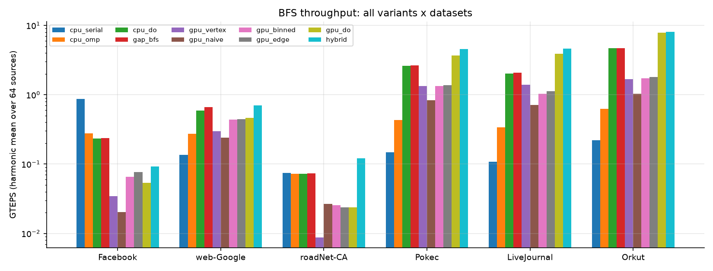

*Figure 4: BFS GTEPS (harmonic mean over 64 sources, log scale).*

Median ms per traversal:

| variant | Facebook | web-Google | roadNet-CA | Pokec | LiveJournal | Orkut |
|---|---|---|---|---|---|---|
| cpu_serial | **0.10** | 31.2 | 36.7 | 151 | 401 | 541 |
| cpu_omp (8 thr) | 0.31 | 14.9 | 37.7 | 51.2 | 126 | 188 |
| cpu_do (8 thr) | 0.36 | 6.95 | 38.0 | 8.07 | 20.7 | 25.1 |
| GAP bfs (8 thr) | 0.35 | 6.23 | 37.3 | 8.04 | 20.0 | 24.7 |
| GAP bfs (4 thr) | 0.13 | 7.44 | 21.1 | 9.09 | 25.3 | 27.9 |
| gpu_vertex | 2.65 | 13.6 | 304 | 16.9 | 30.9 | 70.3 |
| gpu_naive | 4.45 | 17.9 | 99.4 | 27.0 | 60.4 | 116 |
| gpu_binned | 1.30 | 9.82 | 104 | 16.7 | 41.6 | 67.0 |
| gpu_edge | 1.13 | 9.91 | 113 | 16.3 | 38.2 | 64.4 |
| gpu_do | 1.56 | 9.14 | 113 | 5.90 | 10.7 | 13.3 |
| hybrid | 0.84 | **6.42** | **22.0** | **4.76** | **8.76** | **13.1** |

**Direction optimization matters most on the social graphs.**
- `gpu_do` is 3–5× faster than the best top-down GPU variant and 1.4–1.9× faster than 8-thread `cpu_do`.
- Bottom-up examines 17M adjacency entries instead of 82M on LiveJournal's three big levels.
- Its random reads hit an n/8-byte bitmap (600 KB) that stays in cache, instead of the 19 MB `dist` array.

The top-down load-balancing variants (`gpu_binned`, `gpu_edge`) improve on `gpu_naive`
by 1.5–1.8×, but they are still bound by random gathers (4.1). That is why the trivial
`gpu_vertex` stays competitive on LiveJournal: it streams `col_idx` in storage order
and benefits from the input ordering's locality (confirmed in 4.8).

**On the star graph, load balancing is essential:**

| variant | median ms |
|---|---|
| gpu_naive | 41.0 |
| gpu_vertex | 14.5 |
| gpu_binned | 1.07 |
| gpu_edge | **0.60** |
| gpu_do | 0.64 |
| hybrid | 0.46 |
| cpu_serial | 0.16 |

`gpu_naive` puts the hub's 100K edges on one thread and is 68× slower than `gpu_edge`.

**Hypothesis check: naive GPU BFS stays under 1 GTEPS on LiveJournal.** Confirmed:
`gpu_naive` reaches 0.71 GTEPS.

**Small graphs.** The GPU loses on ego-Facebook (4K vertices). A serial CPU BFS
finishes in 0.1 ms, less than one GPU round trip.

### 4.4 Per-level time on the road network: `gpu_do` vs hybrid

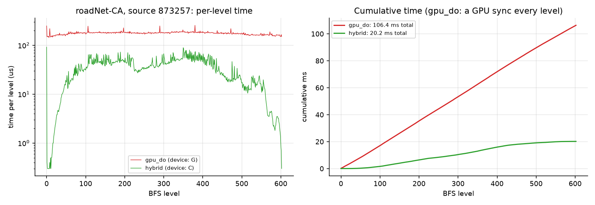

*Figure 5: roadNet-CA, one source (602 levels); time per level and cumulative time.*

Every `gpu_do` level costs ~0.15–0.25 ms, almost independent of its size. That cost
is the commit/wait round trip plus scan and dispatch setup; the actual edge work is
a few µs. 602 levels × ~0.18 ms gives the 106 ms total. (GPU-only time for the same
traversals is ~30 ms.)

The hybrid runs these levels on the CPU at 1–90 µs each, directly on the shared
`dist` and queue buffers, and finishes in 20 ms: **5.1× faster than `gpu_do`**.

**Hypothesis check: GPU-only BFS on roadNet-CA is dominated by per-level sync.**
Confirmed.

Here the "hybrid" is in practice a CPU BFS: no roadNet level exceeds 10⁵ edges. It
runs as fast as 4-thread `cpu_omp` (20.1 ms) and 1.7× faster than serial. The
benefit of unified memory is that switching device costs nothing. On LiveJournal the
same code sends the 2–3 big levels to the GPU and the ~10 small ones to the CPU, and
beats `gpu_do` by 1.2×.

### 4.5 Hybrid threshold sweep

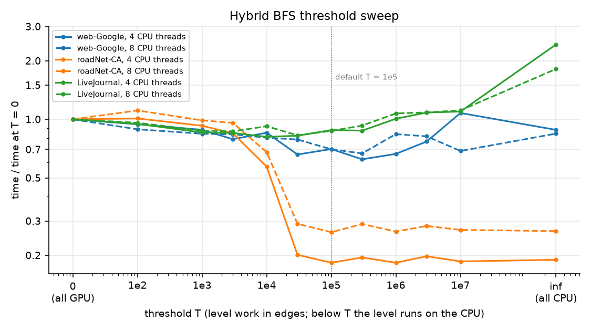

*Figure 6: hybrid time vs threshold T, normalized to T = 0 (all GPU).*

**roadNet-CA.** Time falls 5.5× as soon as T exceeds the size of its largest levels
(~3×10⁴ edges), then stays flat.

**LiveJournal.** The curve is flat from T ≈ 10³ to 3×10⁵ (8.7–9.5 ms). It rises only
when its multi-million-edge bottom-up levels are forced onto the CPU (T ≥ 10⁶; all
CPU = 19–26 ms). Real graphs have few levels near the break-even point: LiveJournal
jumps from 76K-edge to 4.6M-edge levels. So any T in that gap gives the same
assignment of levels to devices.

**Choice of T.** T = 10⁵ is within ~10% of the best T on all three graphs, and it
matches the prediction from the measured costs: ~0.2 ms per GPU level vs ~2 ns per
edge on the CPU.

**CPU threads.** Four CPU threads beat eight on roadNet-CA. See 4.6.

### 4.6 OpenMP scaling and the P/E-core split

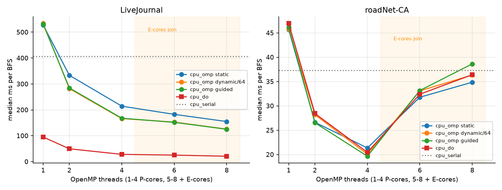

*Figure 7: median ms per BFS vs OpenMP threads. Threads 1–4 run on performance
cores; 5–8 add efficiency cores.*

**LiveJournal.**
- Dynamic and guided scheduling scale to 4.2× at 8 threads.
- **Static is 24% slower at 8 threads** (155 vs 125 ms), and already 18% slower at
  2 threads. With skewed degrees, equal vertex counts are not equal work, and static
  cannot rebalance. Adding E-cores makes this worse, because the slowest thread sets
  the pace at each barrier.
- `cpu_do` keeps scaling to 8 threads (95 → 21 ms).

**roadNet-CA** turns the hypothesis around.
- All schedules are fastest at **4 threads (~20 ms)** and get *slower* as E-cores
  join (35–39 ms at 8 threads, about as slow as serial).
- Static is marginally the best there.
- Each of roadNet's ~600 levels has only ~5K vertices of work, so the run is a
  sequence of ~600 barriers. A barrier that waits for an E-core costs more than the
  extra core adds.

**Hypothesis check: static scheduling underperforms on 4P+4E.** True for the skewed
graph. On the high-diameter graph, the bigger problem is using E-cores at all.

### 4.7 PageRank

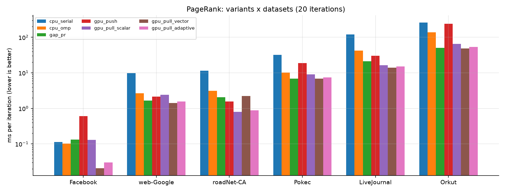

*Figure 8: PageRank ms per iteration (20 iterations, log scale).*

| variant | Facebook | web-Google | roadNet-CA | Pokec | LiveJournal | Orkut |
|---|---|---|---|---|---|---|
| cpu_serial | 0.11 | 9.73 | 11.5 | 32.4 | 122 | 259 |
| cpu_omp (8 thr) | 0.10 | 2.67 | 3.11 | 10.2 | 42.5 | 138 |
| GAP pr (8 thr) | 0.13 | 1.66 | 2.06 | 6.84 | 21.1 | 51.1 |
| gpu_push | 0.61 | 2.13 | 1.58 | 19.0 | 30.5 | 239 |
| gpu_pull_scalar | 0.13 | 2.41 | **0.80** | 9.00 | 16.3 | 65.8 |
| gpu_pull_vector | **0.021** | **1.43** | 2.22 | **6.84** | **14.0** | **49.0** |
| gpu_pull_adaptive | 0.030 | 1.56 | 0.88 | 7.39 | 15.2 | 53.7 |
| iterations to 1e-6 | 48 | 62 | 57 | 44 | 49 | 45 |

**Hypothesis check: pull beats push.** Confirmed on every graph: 1.5× on web-Google,
2.0× on roadNet, 2.2× on LiveJournal, 2.8× on Pokec, 4.9× on Orkut.
- Push turns every edge into a random atomic read-modify-write, which is twice the
  traffic of a gather and serializes on hubs.
- Pull does one plain gather per edge and one store per vertex.
- Push was also the hardest variant to make accurate. On the star graph, 100K
  same-signed float atomics into one accumulator round the same way every time
  (L1 error 1e-3). Simdgroup-aggregated atomics plus a compensated low-order
  accumulator bring this to 4e-7.

**Hypothesis check: vector wins on high-degree graphs, scalar on roadNet-CA.**
Confirmed. Vector (32 lanes per vertex, coalesced `col_idx` reads) is 1.2–1.7×
faster than scalar on the social and web graphs, but **2.8× slower on roadNet-CA**:
with mean degree 2.8, ~90% of each simdgroup's lanes sit idle.

**Adaptive variant.** It picks per vertex and is **within 10% of the best variant on
every graph**, so it is the robust default when the degree distribution is unknown.
On ego-Facebook its three dispatches cost more than the work.

**Convergence.** Every GPU variant converges in exactly the same number of
iterations as the double-precision reference on all six graphs.

**GPU vs CPU.** Per iteration, the best GPU variant is 1.5× (Pokec) to 4.8×
(Facebook) faster than our 8-thread `cpu_omp`. Against GAP, the advantage is much
smaller (1.0–2.6×), and GAP converges faster in wall time (see 4.12).

**Phase 8 anomaly resolved.** Measured on battery, Orkut `gpu_pull_vector` was
slower in fixed mode than in convergence mode. On AC the two agree (49.0 vs 49.9 ms
per iteration), so the battery state was the cause.

### 4.8 Vertex reordering

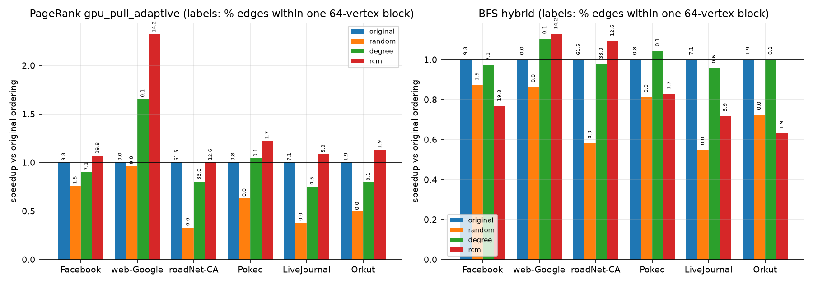

*Figure 9: speedup vs the original labels. Bar labels give the percentage of edges
whose endpoints fall in the same 64-vertex block.*

PageRank `gpu_pull_adaptive`, ms per iteration:

| dataset | original | random | degree | rcm | best vs original | best vs random |
|---|---|---|---|---|---|---|
| Facebook | 0.061 | 0.081 | 0.068 | 0.057 | rcm 1.07x | 1.41x |
| web-Google | 1.56 | 1.61 | 0.94 | **0.67** | rcm 2.32x | 2.41x |
| roadNet-CA | 0.88 | 2.69 | 1.10 | 0.88 | rcm 1.01x | 3.06x |
| Pokec | 7.36 | 11.7 | 7.06 | **6.02** | rcm 1.22x | 1.94x |
| LiveJournal | 15.2 | 39.8 | 20.2 | **14.0** | rcm 1.09x | 2.85x |
| Orkut | 50.2 | 102 | 63.1 | **44.4** | rcm 1.13x | 2.29x |

BFS `hybrid`, median ms:

| dataset | original | random | degree | rcm |
|---|---|---|---|---|
| web-Google | 5.51 | 6.39 | 4.99 | **4.89** |
| roadNet-CA | 22.2 | 38.2 | 22.6 | **20.2** |
| Pokec | 4.83 | 5.94 | **4.62** | 5.84 |
| LiveJournal | **8.75** | 15.9 | 9.13 | 12.2 |
| Orkut | 12.8 | 17.6 | **12.7** | 20.2 |

**Hypothesis check: random labels are much slower.** Confirmed. Random labels slow
PageRank 1.9–3.1× and BFS 1.2–1.8×. On LiveJournal, the gather rate falls from
~4.6 to ~1.8 G/s, close to the uniform-random microbenchmark rate. So the input
orderings already provide most of the locality that real graphs get.

**RCM for PageRank.** RCM is the best ordering for PageRank on every graph. On
web-Google it gives 2.3×: the original labels there are effectively random (0.01% of
edges within a block), and RCM raises that to 14%.

**Degree ordering.** Degree ordering *hurts* the community-structured social graphs.
Grouping hubs breaks up the communities: on LiveJournal, same-block edges drop from
7.1% to 0.6%.

**RCM hurts direction-optimizing BFS** on the social graphs: 0.63× on Orkut and
0.72× on LiveJournal. Bottom-up scans an unvisited vertex's neighbors in ID order
and stops at the first one in the frontier. Original and degree labels give early,
high-degree vertices low IDs, so scans hit early. RCM gives low IDs to the
peripheral vertices that are discovered *last*. A LiveJournal trace shows bottom-up
examining 44.3M adjacency entries under RCM vs 22.2M under the original order.

**No single ordering is best for both algorithms.** PageRank wants RCM; bottom-up
BFS wants hub-first IDs.

### 4.9 Throughput vs graph size

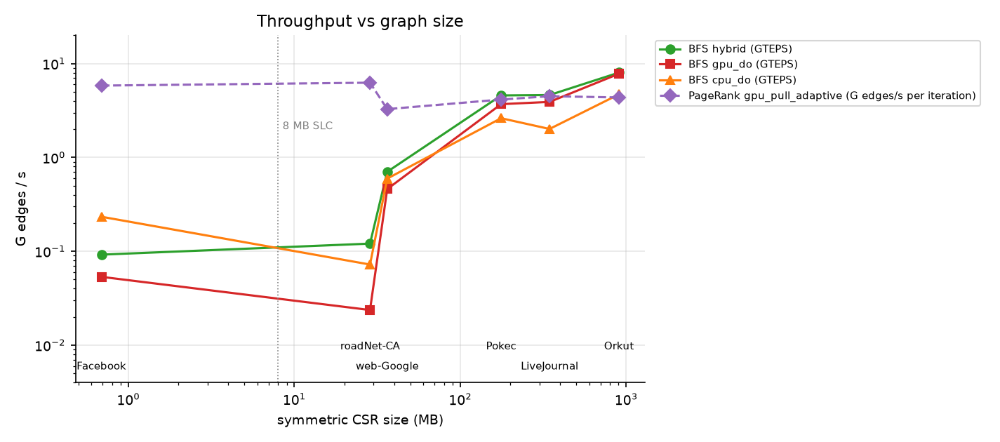

*Figure 10: throughput vs symmetric CSR size. BFS in GTEPS; PageRank in edges
processed per second per iteration.*

**Hypothesis check: smaller graphs (web-Google) get higher GTEPS from the 8 MB cache.**
Wrong for BFS: GTEPS *grows* with graph size, from 0.05–0.23 on Facebook to 8 on
Orkut. BFS on small graphs is bound by fixed per-level costs, not memory. A
traversal of web-Google (16 levels, 4M edges) spends most of its time in
dispatches and syncs, while Orkut has 117M edges to spread over 8 levels.
roadNet-CA is the extreme case: 28 MB, but 600 levels.

**PageRank** shows the expected cache effect only weakly.
- Small graphs whose vectors fit in cache (Facebook, roadNet-CA with its local
  ordering) process ~6 G edges/s.
- The large social graphs settle at ~4 G edges/s.
- web-Google drops to 3.3 G edges/s because its labels are random (4.8), not because
  of its size.

Locality matters more than size.

### 4.10 Bandwidth efficiency

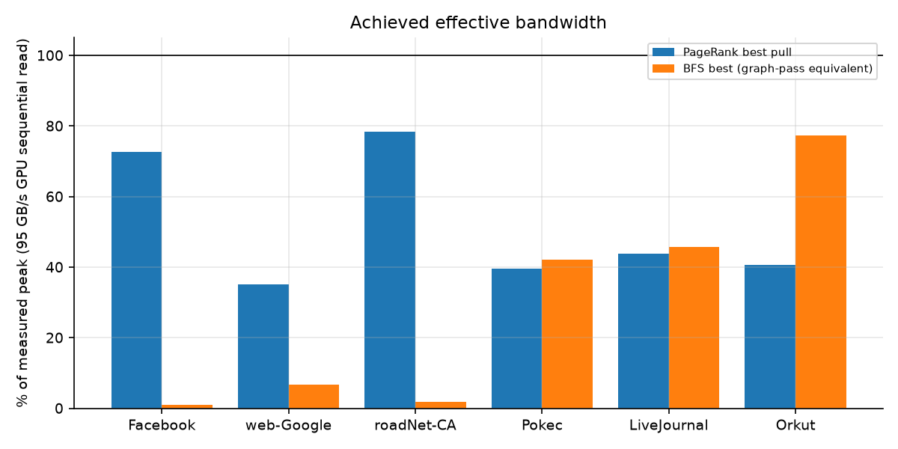

*Figure 11: effective bandwidth as a percentage of the measured 95 GB/s.*

**PageRank.** Bytes per iteration = 4(n+1) + 8m + 4n: row pointers, column indices,
the gathered contributions, and the output.
- The best pull kernel reaches **78% of peak on roadNet-CA** and 73% on Facebook,
  where gathers behave almost like streaming.
- The social graphs reach ~40%. Half of their counted bytes are random 4-byte
  gathers that each pull a 64–128-byte line.

**BFS.** The bars are a "graph-pass equivalent": one read of the CSR and `dist` per
traversal. Direction-optimizing BFS skips most edges, so Orkut's 77% means "as fast
as streaming 77% of the graph at peak bandwidth". It does not mean the DRAM bus was
77% busy. The road and small graphs reach 1–7%: they are bound by latency and
synchronization, not by bandwidth.

**GTEPS per GB/s.** Raw GTEPS from data-center GPUs with 1–3 TB/s HBM are not
comparable to a 100 GB/s laptop chip, so we normalize by measured bandwidth:

| dataset | best BFS variant | GTEPS | MTEPS per GB/s |
|---|---|---|---|
| Facebook | cpu_serial | 0.86 | 9.1 |
| web-Google | hybrid | 0.70 | 7.4 |
| roadNet-CA | GAP bfs, 4 threads | 0.13 | 1.4 |
| Pokec | hybrid | 4.58 | 48.1 |
| LiveJournal | hybrid | 4.63 | 48.6 |
| Orkut | hybrid | 8.03 | **84.3** |

To compare with a published result, divide its GTEPS by its device's measured
bandwidth. This normalization favors direction-optimizing codes on low-diameter
graphs, just as raw GTEPS does: the same TEPS denominator applies to every variant.

### 4.11 Threadgroup size

The main kernels were swept over threadgroup sizes 64–1024 (`scripts/sweep_tg.sh`):
- `gpu_do` on LiveJournal, Pokec, Orkut
- `gpu_pull_vector` and `gpu_pull_adaptive` on four graphs

All differences are within 5% for PageRank and within 10% for `gpu_do`, about the
run-to-run noise, with no consistent winner. Examples:

| kernel | graph | 64 | 256 | 1024 |
|---|---|---|---|---|
| gpu_do | Orkut (ms) | 17.8 | 17.2 | 18.5 |
| gpu_pull_adaptive | Orkut (ms/it) | 51.2 | 50.3 | 51.5 |
| gpu_pull_adaptive | roadNet (ms/it) | 0.875 | 0.868 | 0.887 |

These kernels are bound by memory latency, not occupancy, so the default stays at 256.

### 4.12 External baseline: the GAP Benchmark Suite

GAP (Beamer et al., commit `941462c`) is built with Apple clang and Homebrew libomp
by `scripts/gap.sh`. Its Makefile assumes GCC's `-fopenmp`, so we pass
`-Xpreprocessor -fopenmp` and libomp's paths on the make command line instead of
patching it, with the same `-O3 -march=native` as our build.

**Same graphs and sources.** `build/gexport` writes each `.bin` as GAP's `.sg`
serialized CSR, so GAP runs on exactly our graphs. BFS uses the symmetrized graph;
PageRank uses the directed graph with its transpose. BFS runs from our same 64
sources (`-r`), 1 warm-up + 5 timed trials each, and uses our GTEPS denominators.
GAP's own verifier passed for every source and every PageRank graph. Results:
`results/gap_{bfs,pr,pr_converge}.csv`. Peak memory was 1.0 GB.

**BFS: our CPU baseline holds up, and the GPU hybrid beats GAP.**
- GAP at 8 threads is within 0–2% of our `cpu_do` on every graph except web-Google,
  where it is 10% faster (6.23 vs 6.95 ms). Both implement the same Beamer
  algorithm with the same α/β.
- The hybrid is **1.7× (Pokec), 2.3× (LiveJournal) and 1.9× (Orkut)** faster than
  GAP. On web-Google it is 3% slower.
- On roadNet-CA, GAP with 4 threads (21.1 ms) is 4% faster than the hybrid (22.0 ms).
  This confirms 4.4: there the hybrid *is* a CPU BFS, and the P-core-only CPU
  wins. GAP with 8 threads is 1.8× slower than with 4 on roadNet, the same E-core
  barrier effect as in 4.6.

**PageRank per iteration: GAP is a much stronger CPU baseline than our `cpu_omp`.**
GAP is 1.5–2.7× faster per iteration than our `cpu_omp` on the larger graphs. The
reasons are visible in the two codes:
- GAP keeps scores in float, so the randomly gathered contribution array is half
  the size (19 MB vs 39 MB on LiveJournal).
- GAP computes each vertex's outgoing contribution in the same loop that updates
  it. Ours uses a separate pass, plus a serial copy of the double rank vector every
  iteration.

Against GAP, the best GPU variant is:
- 2.6× faster on roadNet-CA and 1.5× on LiveJournal
- 1.2× on web-Google
- only **1.0–1.04× on Pokec and Orkut**

The social graphs' GPU kernels reach only ~40% of bandwidth, because of random
gathers (4.10). The CPU has the same latency problem (4.1), but GAP's float vectors
fit its caches better.

**PageRank to convergence: GAP wins.** Time to tol 1e-6, in ms (iterations):

| dataset | our cpu_omp | GAP pr (8 thr) | best GPU pull | GPU vs GAP |
|---|---|---|---|---|
| Facebook | 4.70 (48) | 4.50 (33) | 9.51 (48, vector) | 0.47× |
| web-Google | 186 (62) | 53.8 (32) | 107 (62, vector) | 0.50× |
| roadNet-CA | 205 (57) | 65.0 (34) | 72.7 (57, adaptive) | 0.89× |
| Pokec | 484 (44) | 197 (29) | 320 (44, vector) | 0.62× |
| LiveJournal | 2132 (49) | 650 (31) | 719 (49, vector) | 0.90× |
| Orkut | 6306 (45) | 1522 (29) | 2247 (45, vector) | 0.68× |

GAP updates scores **in place (Gauss–Seidel)**: a vertex sees neighbors' new values
from the same sweep. It reaches tol 1e-6 in 29–34 iterations, against 44–62 for the
Jacobi iteration used by our CPU reference and all GPU variants. That 31–48% cut in
iterations outweighs the GPU's per-iteration lead on every graph. GAP's time to
solution is 1.1× (LiveJournal, roadNet) to 2.1× (Facebook, web-Google) better.

Two caveats make this comparison indicative, not exact:
- **The fixed point differs.** GAP's kernel does not redistribute dangling mass, so
  its ranks are a different vector from ours; its accuracy was checked only by GAP's
  own verifier.
- **The stopping rule differs.** Its stopping test measures change *during* a sweep,
  and its iteration count varies run to run (Orkut 23–30), because parallel
  in-place updates race.

Still, the lesson is clear. **The algorithmic choice (Gauss–Seidel vs Jacobi) is
worth as much as the hardware choice here.** The GPU kernels could adopt it:
in-place, race-tolerant updates need no synchronization beyond what the pull
kernels already do. It is listed as future work.

## 5. Summary of hypotheses (PLAN §10)

| hypothesis | outcome |
|---|---|
| Naive GPU BFS < 1 GTEPS on LiveJournal; suffers on star; balancing and DO give large multiples | **Confirmed.** 0.71 GTEPS; 68× on star from balancing; DO gives 3–5× on social graphs. Top-down balancing alone gives only 1.5–1.8× (gather-bound) |
| roadNet-CA GPU BFS is sync-bound; hybrid wins | **Confirmed.** ~0.18 ms per level × 600 levels; hybrid 5.1× faster than `gpu_do` |
| Static OpenMP underperforms on 4P+4E | **Confirmed on LiveJournal** (24%). On roadNet-CA, E-cores slow every schedule; 4 threads is best |
| Pull beats push; vector wins on high degree; scalar may win on roadNet-CA | **Confirmed** (1.5–4.9×; scalar 2.8× faster on roadNet-CA) |
| Random ordering much slower; RCM/degree may improve | **Confirmed for random** (1.9–3.1×). RCM helps PageRank (up to 2.3×) but hurts DO-BFS on social graphs; degree helps only web-Google |
| Smaller graphs have higher GTEPS due to the cache | **Wrong for BFS** (fixed per-level costs dominate small graphs). Weakly true for PageRank, where locality matters more |
| (Phase 11) GAP as the state-of-the-art CPU baseline | Our `cpu_do` matches GAP's BFS; the hybrid beats it 1.7–2.3× on social graphs. GAP's PageRank nearly ties the GPU per iteration on Pokec/Orkut and wins to convergence through Gauss–Seidel |

## 6. Limitations

- **One machine, one run.** All numbers come from a single 8 GB M2, run once per
  configuration with 5 trials. Thermal state was not controlled beyond AC power and
  other apps closed. Run-to-run variation is ~5–10% for GPU BFS.
- **Sub-0.1 ms measurements are noisy.** For the smallest kernels (ego-Facebook
  PageRank at ~0.02–0.06 ms per iteration), the same configuration varied up to 2×
  between `pr.csv` and `reorder_pr.csv`, because a 20-iteration run is then
  comparable to command-buffer overhead and GPU clock ramp-up. Conclusions are not
  drawn from these numbers.
- **One host sync per level.** All GPU BFS variants sync once per level. Indirect
  dispatch, which would encode many levels per command buffer, was not
  implemented, so GPU-only BFS on high-diameter graphs is worse than it needs to be.
- **Float on GPU.** Metal has no double. GPU PageRank is float with Kahan
  summation, which is valid only with fast math off. On adversarial graphs it can
  hit a float convergence floor above tol; a stagnation guard handles that case.
- **Graph size.** The 8 GB memory limits graphs to ~250M stored edges (Orkut) under
  the 3 GB process budget. Larger graphs (Friendster, Twitter) were not run.
- **Our CPU PageRank baseline is weak.** `cpu_omp` (double, separate contribution
  pass, serial copy) is 1.5–2.7× slower per iteration than GAP. GPU-vs-CPU PageRank
  claims should be read against GAP (4.12), not against `cpu_omp`.
- **GAP PageRank is not the same computation.** It uses Gauss–Seidel and has no
  dangling redistribution, so only timing, not ranks, is compared.
- **`hybrid` on roadNet-CA is effectively a CPU BFS.** Its win there shows that
  switching device is free, not that the GPU helped.

## 7. Future work

- **Indirect dispatch / GPU-driven levels.** Encode several BFS levels per command
  buffer, with a small kernel sizing the next grid. This would attack the ~0.2 ms
  per-level cost that limits roadNet-CA and the tails of every traversal.
- **Hub-first neighbor order inside adjacency lists, keeping RCM labels.** This
  could combine RCM's PageRank locality with fast bottom-up exits (4.8).
- **Restrict OpenMP to P-cores** (thread affinity / QoS classes) for barrier-heavy
  phases, and give E-cores only independent work.
- **Gauss–Seidel (in-place) PageRank on the GPU.** GAP's in-place updates need
  31–48% fewer iterations (4.12). A GPU pull kernel that writes the new
  contribution in place would get most of that benefit. Validation would then
  need a convergence-based check rather than iteration-count agreement.
- **Compressed or 16-bit-delta CSR** to fit larger graphs in 8 GB and to reduce
  bytes per edge on this bandwidth-bound chip.
- **Asynchronous / delta PageRank**, which touches only vertices whose rank still
  changes.

## References

1. S. Beamer, K. Asanović, D. Patterson. *Direction-Optimizing Breadth-First Search.*
   SC '12: Proc. Int. Conf. for High Performance Computing, Networking, Storage and
   Analysis, 2012.
2. D. Merrill, M. Garland, A. Grimshaw. *Scalable GPU Graph Traversal.* PPoPP '12:
   Proc. 17th ACM SIGPLAN Symp. on Principles and Practice of Parallel Programming,
   2012.
3. S. Beamer, K. Asanović, D. Patterson. *The GAP Benchmark Suite.*
   arXiv:1508.03619, 2015. https://github.com/sbeamer/gapbs
4. Graph500 Steering Committee. *Graph500 Benchmark Specification* (BFS kernel,
   TEPS metric). https://graph500.org
5. J. Leskovec, A. Krevl. *SNAP Datasets: Stanford Large Network Dataset Collection.*
   http://snap.stanford.edu/data, 2014.
6. E. Cuthill, J. McKee. *Reducing the Bandwidth of Sparse Symmetric Matrices.*
   Proc. 24th ACM National Conference, 1969.
7. L. Page, S. Brin, R. Motwani, T. Winograd. *The PageRank Citation Ranking:
   Bringing Order to the Web.* Stanford InfoLab Technical Report, 1999.

---
*Reproduce:* `./scripts/run_all.sh` (≈75 min on this machine; the tuning sweeps run
only when named: `./scripts/run_all.sh tuning_balanced tuning_do tuning_tg`); GAP baseline: `./scripts/gap.sh` (≈6 min). Figures: `.venv/bin/python analysis/plots.py`. Tables:
`.venv/bin/python analysis/report_tables.py`.
